### Hi, I'm Clément 👋

I am a first-year Master's student in Computer Science (Data Engineering) at La Rochelle Université, in France.
I like to build small tools that work with real data: a Discord bot for game stats, a CLI that checks CSV files, and the setup of my own Linux desktop.

- 🔭 Now: my [dotfiles](https://github.com/clemlery/dotfiles), a Sway desktop on Fedora, written with Bash
- 🎮 [BrawlPulse](https://github.com/clemlery/BrawlPulse): a Kotlin Discord bot that saves daily Brawlhalla snapshots and shows ELO changes by week, month and year
- 📊 [csvscope](https://github.com/clemlery/csvscope): a Python CLI that reads a CSV file and reports column types, missing values and stats
- 📥 Contact: [lerouleyclement@gmail.com](mailto:lerouleyclement@gmail.com)

  
  
  
  
  
  

  
GitHub stats

   
  <picture>
    <source media="(prefers-color-scheme: dark)" srcset="./profile/stats-dark.svg">
    <source media="(prefers-color-scheme: light)" srcset="./profile/stats-light.svg">
    
  </picture>

